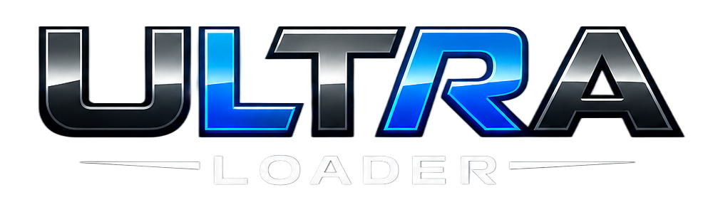
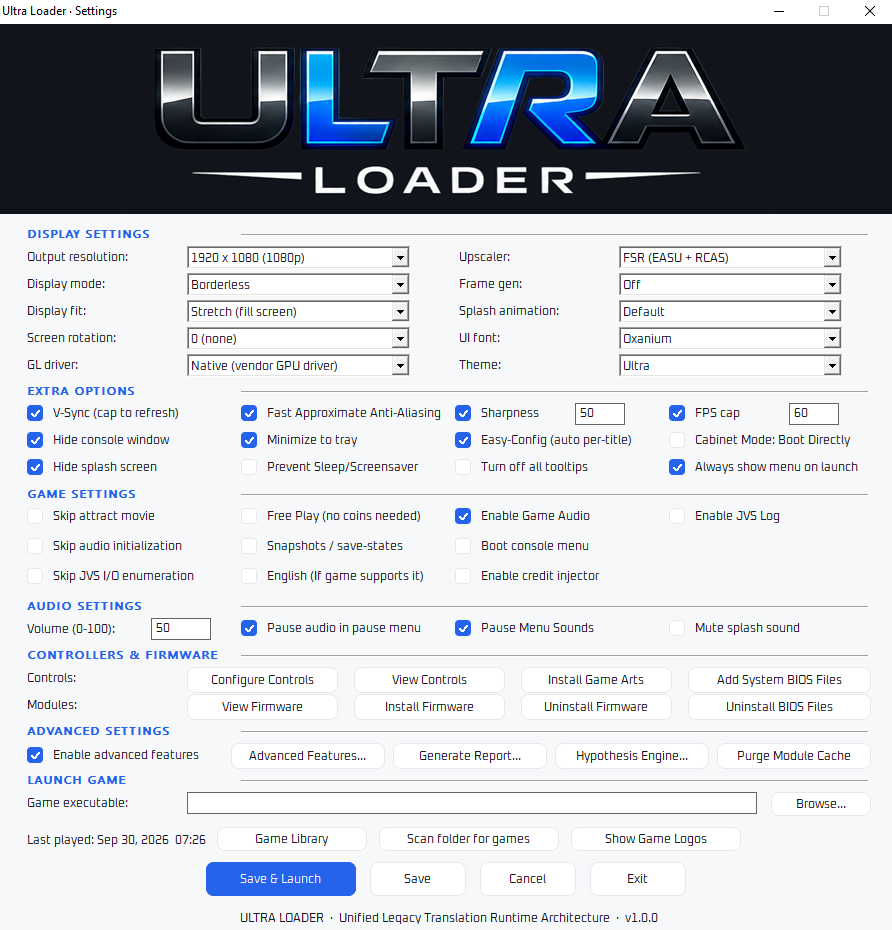
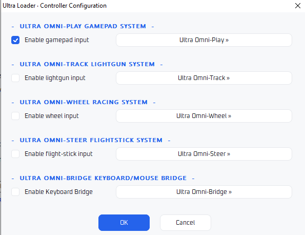
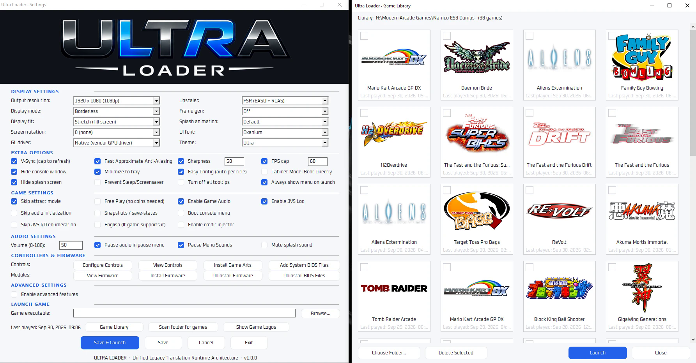
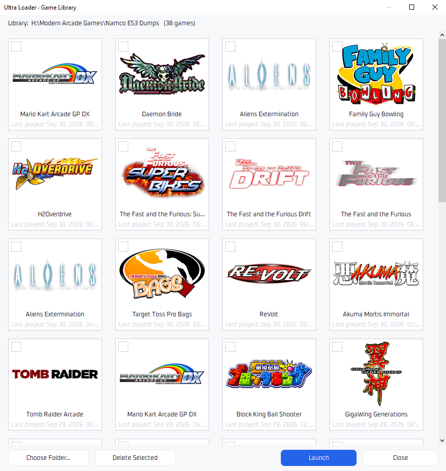
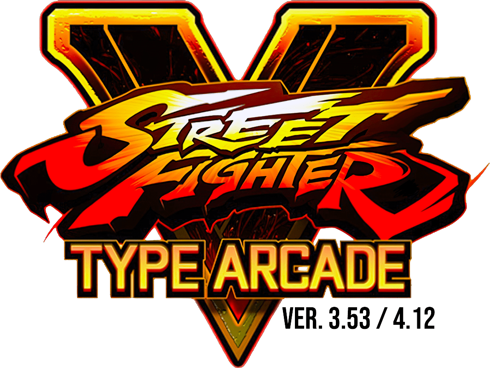
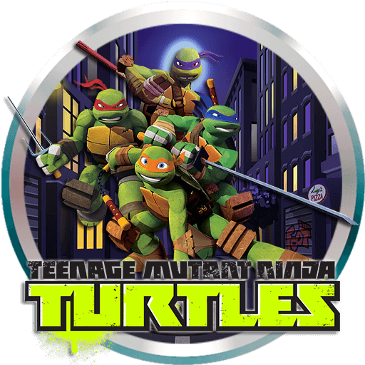

### The native arcade execution engine. Free forever. Built for the community.

**U**nified **L**egacy **T**ranslation **R**untime **A**rchitecture

**[Download](https://github.com/Sleyk-Esrun/Ultra-Loader/releases/latest) · [What is Ultra Loader?](https://ultraloader.org/what-is-ultra-loader) · [Manual](https://ultraloader.org/manual) · [Supported Games](https://ultraloader.org/vote#supported) · [EULA](https://ultraloader.org/eula)**

---

## What is Ultra Loader?

Arcade games are some of the most technically impressive and culturally significant games ever made, and most of them have never been released in any form players can own. When the cabinets age out and the operators move on, those games are simply gone.

**Ultra Loader is here to change that.** It is an original, clean-room arcade execution engine that runs your legal arcade game dumps natively on a Windows PC. No cabinet, no operator, no pay-to-play subscription gatekept behind someone else's wallet. One engine, one unified library, every supported board.

> It contains **no** copyrighted game code, **no** extracted assets, and **no** third-party firmware. You bring your own game files. We built the engine. You decide how to use it.

 
<i>The Ultra Loader main window: every option on one screen. (Click to view full size.)</i>

---

## Why Use Ultra Loader?

**One loader for everything.** Namco, Sega, Taito, Konami, Raw Thrills and more: dozens of modern arcade boards in a single app, with one UI, one library, and one set of services. No juggling a different tool for every system.

**Fast, free, and it stays that way.** Native speed, no paywall, no gatekeeping, no telemetry. Every user gets the same full-powered software, forever.

**It preserves what would otherwise be lost.** These games were built for hardware that ages out and operators who move on. Ultra Loader lets them live on PCs that anyone can own.

### Bringing games up takes the whole community

Here's the honest part. Getting an arcade board running *right* is hard, patient work: tracing protocols, hooking I/O, fixing one stubborn game at a time. It doesn't happen overnight, and it never happens through one person hoarding the keys.

That's exactly why the modules are **open**. **Imagine 20 or 30 people pushing boards forward together** instead of waiting on a single gatekeeper. Share what you learn. Fix a game, open a pull request, help the next person up.

So please, **be patient** with what's still in bring-up, and **support the people doing the work**. Report issues, test fixes, contribute what you can. Stop rewarding the selfish, pay-to-play model; build the open one, together. **This is the way.**

---

## The ULTRA Way

Four steps. No per-game setup, no config spelunking, no launcher babysitting.

1. **Install.** Download the loader, extract the folder, run `ultra-loader.exe`.
2. **Install Modules.** Choose a game module you wish to play and install it directly into the loader. The loader plays a sound to let you know it installed.
3. **Select.** Browse your legal game dumps and pick the game's executable (`.exe`).
4. **Launch.** Press *Save and Launch*. Ultra Loader detects the board, loads the right module, and wires up omni-services (lightgun support, force feedback, wheels, flight sticks, card readers, credits) automatically. No further setup required.

---

## Omni-Services

Plug in your hardware and go. Ultra Loader detects what you have and wires it straight to the game, with no per-game remapping and no external tools:

- **Ultra Omni-Play.** The gamepad system: any controller works across every board, with per-stick deadzone, sensitivity, and curve tuning.
- **Ultra Omni-Track.** The lightgun system: per-player calibration, X/Y offsets, offscreen reload, on-screen borders, and automatic per-title profiles.
- **Ultra Omni-Wheel.** The racing system: force-feedback wheels with steering deadzone, sensitivity and curve, plus automatic per-title profiles.
- **Ultra Omni-Steer.** The flightstick system: HOTAS controls with force feedback, throttle, and full axis inversion.
- **Ultra Omni-Bridge.** The keyboard and mouse bridge: play games that only take keyboard and mouse input using your gamepad.

Card readers (card-in progression) and a credit injector (hotkey or auto-insert coins) are wired up too. One page configures all of it: set it once and every supported game picks it up.

 
<i>One controller page, five Omni systems. (Click to view full size.)</i>

---

## Built for Speed

Ultra Loader is written in **native C** and ships as a single lightweight executable with its UI, fonts, audio, splash and boot animation **embedded**. There's no managed runtime to spin up, no framework to load, and no per-game project files to parse before anything happens. The window and your entire game library are on screen the instant you double-click it.

That's a different class of responsiveness than managed, .NET-based launchers like **TeknoParrot**:

| | **Ultra Loader** | **TeknoParrot** |
|---|---|---|
| Core | Native C, single small `.exe` | Managed .NET / WPF launcher |
| Cold start | Near-instant: library shows immediately | Waits on the .NET runtime and UI framework to load |
| Launch path | Straight into a native injector/host | Through a managed launcher layer |
| Library | One unified grid that remembers **every** game you've ever launched | Per-game profiles you add and manage |
| Footprint | Lean; assets embedded in the exe | Framework and launcher dependencies |

The result: you spend time **playing**, not waiting on a launcher. Pick a game, press **Save & Launch**, and you're in.

---

## Download & Run

1. Grab the latest **[Windows release](https://github.com/Sleyk-Esrun/Ultra-Loader/releases/latest)**.
2. Extract the **`Ultra Loader`** folder anywhere (your Desktop is fine).
3. Run **`ultra-loader.exe`**.

Everything the loader needs is embedded. On first run it writes its own `ultra.ini`, and it creates its `art\` folders automatically when you install art packs. **Game-art packs** and **per-game firmware** are distributed separately and install from inside the loader.

---

## Settings and Library, Side by Side

 
<i>Open your game library right next to the settings. Every option in one place: display, upscaling, controllers, firmware, audio. Pick a game, hit <b>Save &amp; Launch</b>, and the loader detects the board and wires up every service automatically. (Click to view full size.)</i>

---

## Game Library

 
<i>Your whole collection as a wall of art. (Click to view full size.)</i>

A single, art-driven grid of your games, each tile its own logo. The library is a **persistent, cross-folder history**: every game you launch is remembered and stays on the wall, no matter which folder it lives in. No re-adding, no per-game setup.

**Launch straight from the wall.** Don't feel like browsing File Explorer for the same game over and over? Once your library is populated, you never have to. Just find your logo, hit **Launch**, and the game boots automatically. One click instead of digging through folder after folder, saving you time navigating.

Curate it your way: tick the checkbox on any tile and hit **Delete Selected** to remove entries you don't want shown. (It only hides them from the grid; your game files are never touched.)

---

## Library Art Styles

<table>
<tr>
<td align="center"> <b>Clear Style</b></td>
<td align="center"> <b>Silver Ring</b></td>
</tr>
</table>
<i>Two built-in logo-art styles for your library. Art packs install from inside the loader.</i>

---

## Supported System Boards

The open-source board modules in this repository (`modules/`) cover **43 modern arcade system boards**:

| Manufacturer | Boards |
|---|---|
| **Namco** | BNA1, ES1, ES2, ES2+, ES3, ES4, N2 |
| **Sega** | ALLS, ALLS UX, Europa-R, Lindbergh, Nu, Nu2, Nu SX, RingEdge, RingEdge 2, RingWide, System SP |
| **Taito** | Type X, Type X², Type X³, Type X⁴, Type X+, Type X Zero, NESiCA, NESiCA 2 |
| **Konami** | BEMANI (PC), Arcade PC |
| **Raw Thrills** | G5, PC |
| **Adrenaline Amusements** | AA |
| **Andamiro** | PC+ |
| **Cave** | PC |
| **Examu** | eX-Board |
| **Global VR** | PC |
| **IGS** | PC |
| **Incredible Technologies** | ICE PC, IT PC |
| **Play Mechanix** | PC |
| **UNICO / UNIS / Wahlap** | UNICO PC, UNIS, Wahlap WPC |
| **Generic** | Generic PC |

Each board lives in `modules/<board>/` as original source: hook code, board I/O, profiles, and compatibility logic.

---

## This Repository

| What | Where |
|---|---|
| **Open-source board module source** | `modules/` (this repo) |
| **Windows loader (binary)** | [Releases](https://github.com/Sleyk-Esrun/Ultra-Loader/releases) |
| **Per-game firmware (`.ufw`)** | Installed from inside the loader |
| **Game-art packs** | Installed from inside the loader |

The loader itself is proprietary and free (see the [EULA](https://ultraloader.org/eula)). The **board modules are open**, made to be read, improved, and extended by the community.

---

## The Commitment

These are promises, in writing, where anyone can find them:

- **Always free.** No subscription, no paywall, no tier system. Ever.
- **No game access is ever paywalled.** Every user gets the same software with the same capabilities.
- **No telemetry.** Nothing leaves your machine unless you choose to send a bug report.
- **All R&D goes back to the community** at no cost.

---

## Contributing

The board modules are open so the community can make them better.

- Fix a bug, improve compatibility, or bring up a new game on an existing board.
- Keep it **clean-room**: original work only. No copyrighted game code, no extracted assets, no third-party firmware, and no code or references from any competing loader or tool.
- By contributing, you license your work under the [Ultra Loader Community License](LICENSE).

Open an issue or a pull request. Every improvement is returned to everyone.

---

## License

The open components (board modules and firmware modules) are released under the **[Ultra Loader Community License](LICENSE)**: free, open, non-commercial, share-alike. The Loader binary is proprietary and free under the **[EULA](https://ultraloader.org/eula)**.

---

**ULTRA LOADER** · by **Sleyk** · [ultraloader.org](https://ultraloader.org)

*Rendering pay-to-play obsolete.*

